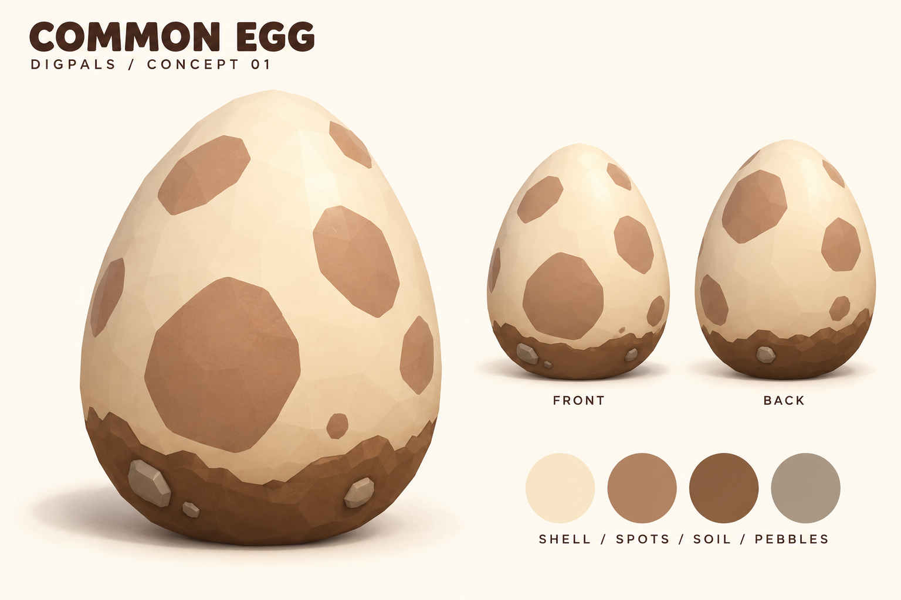

# Common Egg — Konsep Tertulis

## Ringkasan

Common Egg adalah telur paling dasar yang dapat ditemukan pemain saat menggali. Desainnya harus terasa sederhana, hangat, dan dekat dengan tanah agar langsung terbaca sebagai hadiah awal yang sering ditemukan. Walaupun berada di tingkat Common, bentuknya tetap menarik dan memuaskan untuk dikoleksi serta ditetaskan.

Nama dalam game: **Common Egg**  
Tema visual: **telur tanah**  
Rarity: **Common**  
Kesan utama: **ramah, sederhana, kokoh, baru ditemukan dari dalam tanah**

## Cerita Visual

Telur ini terkubur tidak terlalu dalam dan telah lama bersentuhan dengan tanah. Cangkangnya masih utuh, tetapi bagian bawahnya menyimpan lapisan tanah kering dan beberapa kerikil kecil. Bercak cokelat pada cangkang membuatnya mudah dikenali tanpa memberi kesan langka atau magis.

Common Egg menjadi perkenalan pemain terhadap sistem penetasan. Karena itu, tampilannya harus mudah dipahami dalam sekali lihat: ini adalah telur biasa dari dunia DigPals yang menyimpan kemungkinan kejutan kecil.

## Bentuk dan Siluet

- Bentuk dasar telur tegak dengan bagian bawah lebar dan stabil.
- Puncak telur membulat dan sedikit lebih sempit, tanpa ujung tajam.
- Siluet dibuat gemuk dan bersahabat agar sesuai dengan gaya pet DigPals.
- Permukaan menggunakan bidang low-poly yang halus dan tidak terlalu ramai.
- Proporsi acuan: tinggi sekitar 1,3–1,4 kali lebarnya.
- Telur harus tetap terbaca jelas pada ukuran ikon kecil dan dari jarak menengah di dunia game.

## Warna dan Material

Palet utama menggunakan warna alami dengan kontras lembut:

| Bagian | Arah warna | Karakter material |
| --- | --- | --- |
| Cangkang | Krem gading hangat | Matte dengan highlight lembut |
| Bercak | Cokelat tanah liat muda | Menyatu dengan cangkang, tanpa tonjolan |
| Tanah bawah | Cokelat tanah gelap | Matte, sedikit kasar |
| Kerikil | Abu-abu kecokelatan | Matte dengan bidang low-poly sederhana |

Cangkang memiliki 5–7 bercak besar berbentuk tidak beraturan. Sebarannya renggang dan tidak simetris agar setiap sisi terlihat alami. Bercak merupakan warna pada permukaan cangkang, bukan objek terpisah.

Lapisan tanah hanya menutup sekitar seperlima bagian terbawah. Tepi atas tanah dibuat tidak rata untuk memberi kesan telur baru diangkat dari galian. Gunakan 2–3 kerikil kecil sebagai aksen; jumlahnya harus dijaga agar siluet tidak terlihat berat.

## Aturan Desain

Elemen wajib:

- Cangkang krem hangat.
- Bercak cokelat besar dan sederhana.
- Lapisan tanah tipis pada bagian bawah.
- Sedikit kerikil kecil.
- Bentuk low-poly yang bulat dan mudah dibaca.

Hindari wajah, anggota tubuh, rumput, daun, sarang, pita, perhiasan, logam, kristal, retakan bercahaya, aura, partikel magis permanen, dan dekorasi mewah. Common Egg harus menjadi dasar visual yang jelas bagi rarity telur di atasnya.

## Animasi

### Idle

Telur diam dengan gerakan naik-turun yang sangat halus. Sesekali telur miring kecil ke satu sisi lalu kembali ke posisi semula. Gerakannya tenang agar tidak memberi kesan sedang menetas setiap saat.

### Menjelang Menetas

1. Telur bergoyang pendek ke kiri dan kanan.
2. Goyangan kedua sedikit lebih kuat dan cepat.
3. Telur melakukan satu lompatan kecil.
4. Retakan muncul dari bagian atas dan menyebar ke tengah.
5. Cangkang terbuka dengan semburan debu tanah tipis.

Durasi animasi sebaiknya singkat dan terasa ringan. Efek utama berupa debu kecil berwarna cokelat muda, beberapa serpihan cangkang, dan bunyi retak yang lembut. Hindari ledakan besar atau cahaya kuat agar level Common tetap terasa sesuai.

## Audio

- Idle: bunyi gesek tanah yang sangat pelan ketika telur bergoyang.
- Goyang: bunyi ketukan cangkang pendek dan ringan.
- Retak: dua atau tiga bunyi retakan kecil.
- Menetas: bunyi *pop* lembut dengan hembusan debu singkat.

## Identitas Gameplay

Konfigurasi Common Egg saat ini:

| Properti | Nilai |
| --- | ---: |
| Waktu inkubasi | 60 detik |
| Biaya percepatan per menit | 25 |
| Harga jual | 30 |
| Peluang Common | 80% |
| Peluang Uncommon | 17% |
| Peluang Rare | 2,5% |
| Peluang Epic | 0,4% |
| Peluang Legendary | 0,1% |

Peluang kecil mendapatkan pet di atas Common memberi rasa kejutan, tetapi presentasi visual telur tetap sederhana. Kejutan rarity baru diperlihatkan saat proses penetasan atau ketika pet muncul.

## Arahan Produksi 3D

- Gunakan satu mesh telur utama dengan pivot di tengah bawah agar mudah diletakkan dan dianimasikan.
- Pertahankan siluet membulat meskipun memakai geometri low-poly.
- Gunakan UV yang bersih agar bercak tidak meregang di puncak dan dasar telur.
- Tanah dan kerikil dapat menjadi mesh terpisah, tetapi harus mengikuti telur sebagai satu aset.
- Semua bagian dekoratif harus non-collision jika hanya digunakan sebagai visual.
- Siapkan tampilan depan, belakang, dan ikon dengan susunan bercak yang konsisten.
- Pastikan material tidak terlalu mengilap di bawah pencahayaan dunia game.

## Penggunaan di UI

Untuk ikon inventori dan layar penetasan, gunakan sudut tiga perempat dari posisi kamera sedikit lebih tinggi dari tengah telur. Latar belakang sebaiknya sederhana agar siluet krem dan lapisan tanah tetap terbaca. Jangan menambahkan label rarity langsung pada tekstur telur; warna bingkai UI yang menangani informasi rarity.

## Kriteria Selesai

Konsep dianggap berhasil ketika pemain dapat mengenalinya sebagai telur dasar bertema tanah dalam ukuran kecil, bentuknya tetap menarik saat dilihat dekat, dan tampilannya tidak bersaing dengan telur Uncommon atau rarity yang lebih tinggi. Model akhir harus tampak konsisten dari depan dan belakang serta mendukung animasi idle, goyang, retak, dan menetas.

